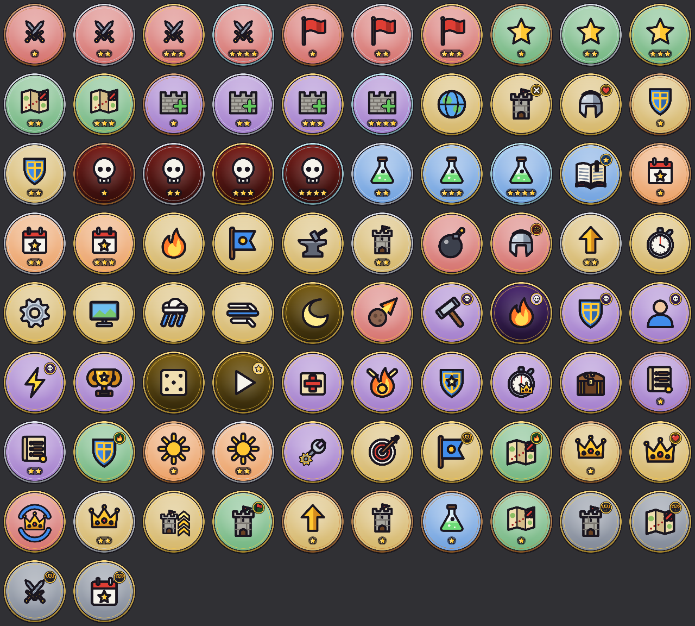
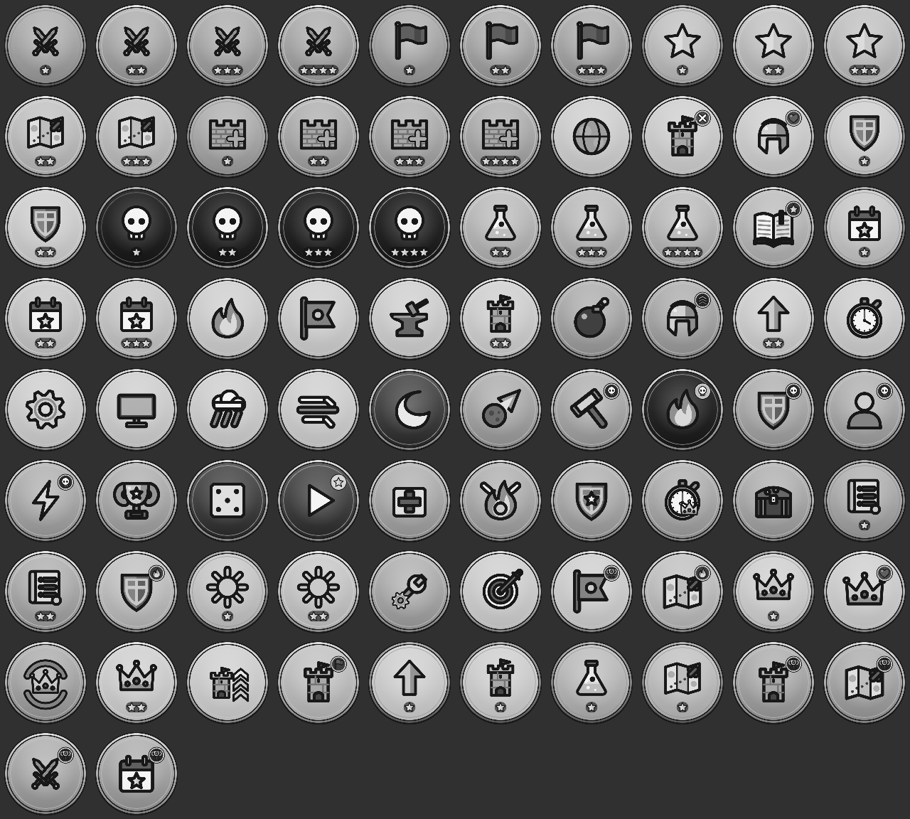

# R9: ikony osiągnięć i rankingów Play Games

Generator: `app/src/test/java/com/centurywar/screens/PgsIconsTest.kt` (Robolectric, grafika
natywna). Ikony 512×512 PNG rysowane kodem symbolami gry (`Icons.draw`), bez tekstu i cyfr.

```
PGS_ICONS=true flock /tmp/claude-0/gradle.lock ./gradlew :app:testDebugUnitTest --tests '*PgsIconsTest*' --rerun
```

Wynik: `app/build/pgs-icons/` — 78 × `ach_<id>.png`, 4 × `lb_<tryb>.png`,
`AchievementsIconsMappings.csv`, `contact.png`, `contact_gray.png`. W repo tylko
`docs/store/assets/pgs/contact.png`, `contact_gray.png` i `AchievementsIconsMappings.csv`.
Spakowanie ZIP-a importu: `docs/store/play_games_sheet.md`, krok 3.





## Styl i mapowanie

- Tarcza w kolorze kategorii: COMBAT czerwień, CAMPAIGN zieleń, ENDLESS fiolet, RESEARCH błękit,
  DAILY pomarańcz, TACTICS złoto; rankingi łupkowe, na przezroczystym tle (czytelne na
  ciemnoszarym, jak na stykówce). Tarcza jasna albo ciemna: generator wybiera wariant
  o większym kontraście symbolu w szarości.
- Obwódka z ciemnym konturem i połyskiem; złota (`Ui.GOLD`) dla osiągnięć pojedynczych.
- Serie: ten sam symbol, **1–4 gwiazdki** na ciemnej belce i obwódka brąz / srebro / złoto /
  platyna (`win_*`, `battles_*`, `stars_*`, `stages_3/16/32`, `wave_*`, `perfect_*`, `kills_*`,
  `first_research` + `research_*`, `daily_1/7/30`, `first_turret` + `turrets_50`,
  `first_evolve` + `evolutions_50`, `weekly_rules_*`, `daily_events_*`, `commander_first` +
  `commander_wins_10`).
- Warianty tego samego symbolu odróżnia znaczek w prawym górnym rogu: bossowie Oblężenia
  (czaszka), „trudne” (płomień), bez wież (krzyżyk / flaga), ocalenie (serce), rankingi (puchar).
- Tabela `id → symbol` jest w jednym miejscu (`specs` w teście); test bez flagi pilnuje, że
  obejmuje cały katalog.

## Kontrole (bez flagi: 7 ikon; z flagą: wszystkie 82)

- 512×512, PNG < 1 MB;
- w kole r = 0,42 boku ≥ 90% pikseli nieprzezroczystych, poza kołem r = 0,5 nic;
- kontrast w szarości: średnia różnica luminancji pikseli symbolu względem tła ≥ 0,25;
- brak dwóch ikon o tym samym SHA-256 pikseli;
- 78 + 4 pliki, mapowanie obejmuje każdy wiersz `AchievementsMetadata.csv` (kolejność
  zgodna z `play_games_sheet.csv`).
